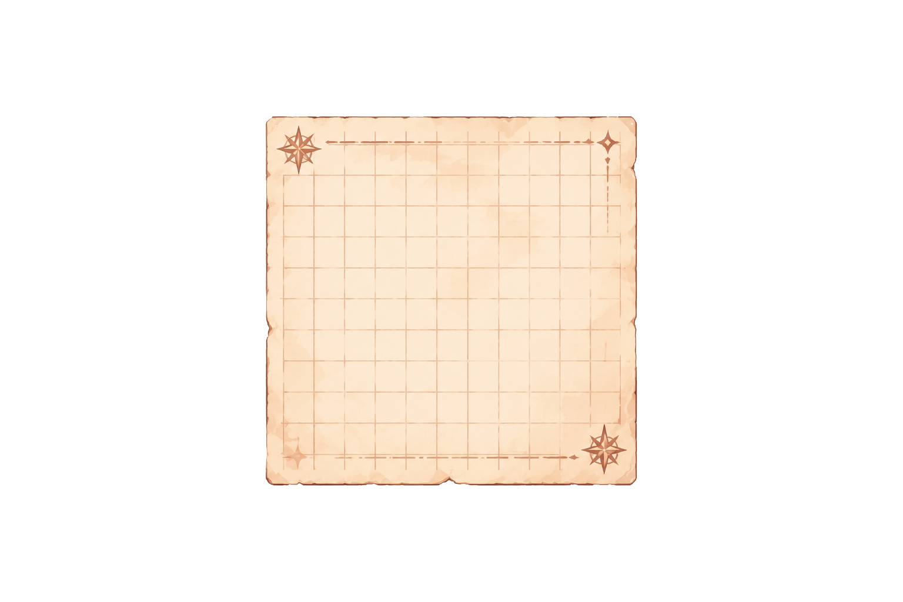

# 前端视觉与交互优化需求规格说明书

## 1. 视觉风格与全局动效调整 (Visual & Global Effects)

- **移除冗余魔法元素**：
	- 全局搜索并彻底移除所有背景或装饰性的“魔法阵”相关组件与 SVG/CSS 动效。   
- **右上至左下“火雨”粒子动效 (Fire Rain Effect)**：
	- 新增全局或英雄区背景粒子层，模拟火雨飘落质感。   
	- **运动轨迹**：从屏幕右上角（Top-Right）向左下角（Bottom-Left）倾斜下落，角度建议在 `225°` 左右，配合渐隐（Opacity Fade）和微弱的重力加速度。   
- **静态纹理素材规范引入**：
	- 引入本地设计纹理资产（替换原抽象 CSS）：
		- 羊皮纸纹理：用于复古卷轴卡片、详情页底衬。   
		- 星屑素材：用于粒子碎光、悬浮点缀。   
		- 方格纸纹理：用于留言墙底板或手记辅助区域。   

## 2. 英雄页与全局组件优化 (Hero & Global Components)

### 2.1 英雄页背景 (Hero Section)

- **降低虚化度**：将原有高斯模糊（`backdrop-filter: blur(...)` / `filter: blur(...)`）参数大幅调低（如从 `20px+` 降低到轻微的 `3px~6px`），保持适度清晰度与背景衬托感，去除“过度雾化”现象。   
- **图片居中与自适应**：
	- 背景图片容器设置：`background-size: cover; background-position: center center;`，或内部 `` 使用 `object-fit: cover; object-position: center;`，确保在各类屏幕比例下视觉焦点居中。   

### 2.2 图标与播放器状态 (Icons & Music Card)

- **图标对齐规范**：统一给 Icon 容器配置 Flex 居中布局（`display: inline-flex; align-items: center; justify-content: center;`），并规范统一的 `font-size` 或 `width/height`，解决大小失调与基线偏离问题。   
- **音乐播放状态反馈**：
	- 当音频处于 `playing` 状态时，播放按钮图标需实时响应，由“播放（▶）”动态切换为“暂停（⏸ / ||）”动效。   

## 3. 页面模块与卡片细节调整 (Views & Cards)

### 3.1 手记卡片 (`PostCard.vue`)

- **图片完整展示**：
	- 调整卡片封面渲染模式，由裁剪式的 `object-fit: cover` 改为自适应保持原比例完整展示（如包含边框的 `object-fit: contain` 或限定比例容器），确保封面不被生硬裁切。   
- **冗余字段剔除**：
	- 移除文章“预估阅读时间”展示模块，保持卡片元信息精炼。   

### 3.2 首页跑马灯/走马灯信息区 (`HomeView.vue`)

- **问题定位**：当前 `.author`、`.text`、`.dia` 元素挤占第一行，导致大容器下半部分大面积留白、排版不均匀。   
- **重构方案**：
	- 调整容器布局为多行或网格流式分布（Flex 纵向撑开 / Grid 分布）：
		- 顶部/首行：展示发帖人昵称 `.author` 与状态标签。   
		- 中间主体：多行平铺展示内容文本 `.text`（允许换行、增大行高与字号，充实框体空间）。   
		- 底部/点缀：菱形符号 `.dia` 居右或作为段落间隔符。   

### 3.3 留言墙交互 (`BoardView.vue`)

- **卡片放大查看 (Modal Preview)**：
	- 留言卡片增加点击事件触发，弹出独立居中的详情 Modal。   
	- Modal 内全尺寸展示留言者的自定义背景（方格纸/纯色/图片）、笔迹字体、完整留言长文本、时间戳与作者信息，增强翻阅的互动体感。   
	- 
	- 
	- 

## 4. 创作者流程与数据维护 (Admin & Creation Workflow)

### 4.1 新建手记封面上传体验

- **交互改造**：
	- 弃用单一的“图片 URL 输入框”形式。   
	- 改为“文件选择上传按钮”（`<input type="file" accept="image/*">`），支持本地选取图片后转为 Base64 / Blob 预览，或触发轻量本地存储处理，大幅缩短发文链路。   

### 4.2 综集管理能力扩展

- **功能新增**：在管理控制台/专栏模块新增 **“添加综集”** 操作入口，支持直接输入综集名称、简介与封面图，无需手动修改底层配置。   

### 4.3 Markdown 一键解析与导入融合

- **流程整合**：
	- 将原本位于“全局导入导出页”的 Markdown 导入逻辑，直接下沉集成到 **“新建手记”** 窗口内。   
	- 弹窗内提供“选择本地 .md 文件”按钮，选取后自动解析 Frontmatter（标题、标签、分类、摘要）并填入表单输入框，将正文注入编辑器，方便用户直接在发文面板中完成图片关联与精修。   